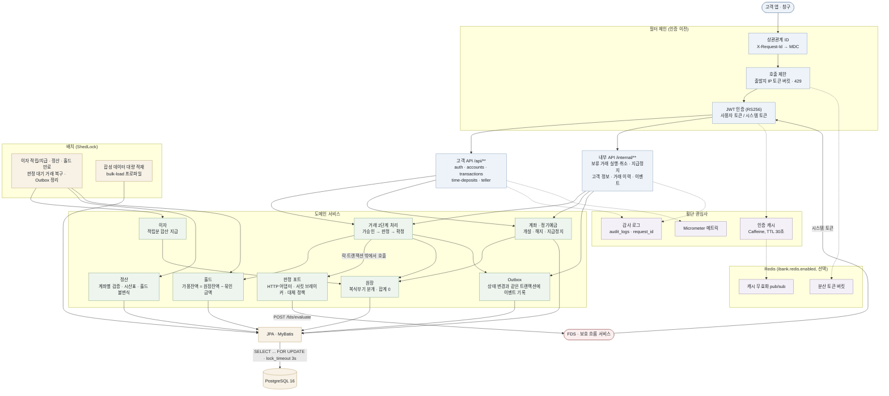
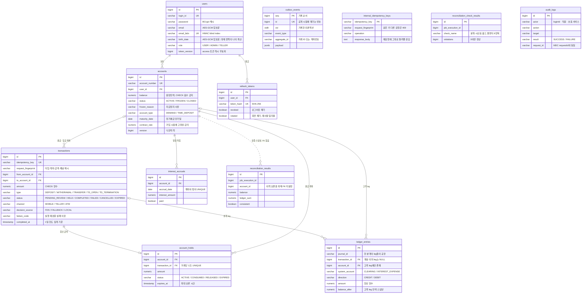

## 개인 프로젝트 - ibank (아주대학교 신우찬)

계좌 개설부터 입출금, 이체, 거래내역 조회 등의 기술을 구현
동시성 제어, 멱등성, 정합성 검증에 중점을 두었으며 그 외에도 금융권에서 중요시하는 개념들을 실제로 구현하고 싶은 생각에서 시작되었습니다.
**여러 요청이 같은 계좌를 동시에 건드려도 잔액이 깨지지 않는가** 라는 질문이 이 프로젝트의 출발점입니다. 실무에 가깝게 만들려고 애썼습니다.

## 팀 프로젝트에서 맡은 역할

지금 ibank는 3인 팀 프로젝트 "고령 고객 보호 뱅킹 시스템"의 계정계 서비스로 쓰이고 있습니다. 역할은 이렇게 나눴습니다.

- **ibank (계정계)**: 계좌·잔액·원장·거래 상태의 원천. 돈이 실제로 움직이는 곳은 여기 하나입니다
- **FDS·보호 흐름 서비스**: 거래마다 승인할지 보류할지 판정하고 보류된 거래를 실행할지 취소할지 정합니다
- **합성 데이터·프론트엔드**: 시연용 고객·거래 데이터와 화면

ibank는 보호자가 누구인지 모릅니다. 판정과 보호 흐름은 전부 FDS 서비스의 몫이고 ibank는 판정 결과를 받아 돈을 묶거나 옮기기만 합니다. 서비스 간 API는 [docs/contracts](docs/contracts/README.md)에 OpenAPI로 먼저 써 두고 구현을 맞췄습니다. 개인 프로젝트 시점(`base-ibank` 태그) 이후 바뀐 내용은 [docs/team-project-changes.md](docs/team-project-changes.md)에 기능별로 정리했습니다.

## 전체 구조

요청 하나가 어떤 순서로 계층을 지나고 그 과정에서 어디가 잠기는지를 그렸습니다. 잔액을 바꾸는 경로는 결국 전부 PostgreSQL의 행 락 한 곳으로 모입니다. FDS 서비스 호출은 그 락 바깥에서만 일어납니다. 배치와 Redis는 본류 바깥에 두었습니다. 둘 다 없어도 단일 인스턴스는 그대로 돌아갑니다.

## 데이터 모델

Flyway 마이그레이션(V1~V32)에 정의된 스키마입니다. Spring Batch 메타데이터, ShedLock, 대량 적재 오류 기록처럼 도메인과 상관이 없는 테이블은 뺐고 컬럼도 설계 의도가 드러나는 것 위주로 추렸습니다. 눈여겨볼 곳은 두 군데입니다. `ledger_entries`의 한 leg는 고객 계좌와 시스템 계정 중 정확히 한쪽에만 귀속되고 같은 `journal_id`를 공유하는 leg들이 모여 합이 0인 분개를 이룹니다. `account_holds`는 돈을 묶기만 하고 원장에는 아무것도 남기지 않습니다.

# 기술 스택

| 구분 |  |
|------|------|
| Language | Java 21 (LTS) |
| Framework | Spring Boot 4.0.6 (Web MVC, Data JPA, Security, Validation, Retry, Actuator, Batch) |
| DB | PostgreSQL 16 |
| 영속성 | JPA(쓰기·무결성) + MyBatis(동적 조회·집계 리포트) |
| Cache / 분산 | Caffeine(로컬) + Redis(분산 호출 제한·캐시 무효화 전파, 선택) |
| Auth | JWT RS256(jjwt, JWKS 공개) + 회전형 Refresh Token + 서비스 간 시스템 토큰 |
| 서비스 연동 | RestClient(연결·응답 타임아웃) + Resilience4j 서킷 브레이커 |
| 관측 | Micrometer · Prometheus · Grafana · 상관관계 ID(MDC) · JSON 로깅 |
| 문서 | OpenAPI 3 (springdoc, Swagger UI) + 서비스 간 계약서(`docs/contracts`) |
| Build | Gradle 8.14 (Kotlin DSL) |
| CI | GitHub Actions |

## API

고객 API

| Method | Endpoint | 설명 | 권한 |
|--------|----------|------|:---:|
| POST | `/api/auth/register` | 회원가입 (생년월일 필수) | — |
| POST | `/api/auth/login` | 로그인 (access + refresh 발급) | — |
| POST | `/api/auth/refresh` | 토큰 회전(재발급) | — |
| POST | `/api/auth/logout` | refresh 토큰 폐기 | — |
| POST | `/api/auth/sessions/invalidate` | 전체 세션 즉시 무효화(계정 도용 신고) | 고객 |
| POST | `/api/accounts` | 계좌 개설 | 고객 |
| GET | `/api/accounts/me` | 내 계좌 목록 (원장잔액·가용잔액·묶인 금액) | 고객 |
| GET | `/api/accounts/{no}` | 계좌 단건 조회 | 고객 |
| DELETE | `/api/accounts/{no}` | 계좌 해지 (잔액 0 필요) | 고객 |
| POST | `/api/transactions/deposit` | 입금 | 고객 |
| POST | `/api/transactions/withdraw` | 출금 (판정 결과에 따라 COMPLETED 또는 HELD) | 고객 |
| POST | `/api/transactions/transfer` | 이체 (판정 결과에 따라 COMPLETED 또는 HELD) | 고객 |
| POST | `/api/time-deposits` | 정기예금 가입 | 고객 |
| POST | `/api/time-deposits/{no}/terminate` | 정기예금 해지 (만기 전이면 중도해지) | 고객 |
| GET | `/api/accounts/{no}/transactions` | 거래내역(페이징·기간필터) | 고객 |
| GET | `/api/accounts/{no}/transactions/search` | 거래 상세 검색(유형·상태·금액대·방향·키워드) | 고객 |
| GET | `/api/accounts/{no}/transactions/summary` | 월별 거래 요약 리포트 | 고객 |
| POST | `/api/teller/withdrawals` | 창구 출금 | 창구 직원 |

내부 API (FDS 서비스용, 시스템 토큰 필요, 변경 요청은 모두 `Idempotency-Key` 필수)

| Method | Endpoint | 설명 |
|--------|----------|------|
| GET | `/.well-known/jwks.json` | 토큰 검증용 공개키 |
| POST | `/internal/auth/token` | 시스템 토큰 발급 (클라이언트 ID·시크릿) |
| GET | `/internal/transactions/{id}` | 거래 상태·홀드·판정 결과 |
| POST | `/internal/transactions/{id}/execute` | 보류 거래 실행 |
| POST | `/internal/transactions/{id}/cancel` | 보류 거래 취소 |
| POST | `/internal/accounts/{no}/freeze` | 지급정지 |
| POST | `/internal/accounts/{no}/unfreeze` | 지급정지 해제 |
| GET | `/internal/customers/{id}/profile` | 판정용 고객 정보 (나이·가입일·계좌, 개인정보 원본 제외) |
| GET | `/internal/accounts/{no}/transactions` | 판정용 거래 이력 |
| GET | `/internal/events?after={id}` | 거래·계좌 이벤트 (Outbox) |

고객 API의 전체 스펙은 OpenAPI로 자동 생성됩니다. 로컬 실행 후 `http://localhost:8080/swagger-ui.html`에서 볼 수 있습니다(운영 프로파일에서는 비노출). 내부 API는 FDS 서비스 담당과 맞춘 계약서 [ibank-internal.openapi.yaml](docs/contracts/ibank-internal.openapi.yaml)이 기준이고 오류 코드도 거기에 다 적어 두었습니다.

## 동시성 제어

이체는 비관적 락(`SELECT ... FOR UPDATE`)으로 처리하며 두 계좌를 항상 계좌번호 오름차순으로 잠가 데드락을 차단합니다. 양방향 이체 100건을 동시에 던지는 테스트로 확인했습니다. 락을 쥔 트랜잭션이 멈추면 뒤 이체가 전부 같이 멈추므로 DB에 `lock_timeout` 3초를 걸어 빨리 실패하고 재시도하는 쪽을 택했습니다.

보류 거래가 생기면서 잠그는 대상이 하나 늘었습니다. 실행·취소·만료·확정이 모두 같은 거래를 건드릴 수 있어서 어디서든 **거래 행 → 계좌(번호 오름차순)** 순서로 잠급니다. 같은 보류 거래에 실행과 취소가 동시에 와도 거래 행 락에서 줄을 서기 때문에 한쪽만 적용되고 다른 쪽은 409를 받습니다.

## 멱등성

거래 요청마다 멱등성 키를 받고 같은 키가 다시 오면 처리 없이 저장된 결과를 돌려줍니다. 검증은 락 전후 두 번 합니다. 같은 키를 든 요청 둘이 동시에 들어오면 늦은 쪽이 락 대기 중 먼저 온 쪽의 커밋을 두 번째 검증에서 보게 됩니다. 같은 키를 다른 금액에 재사용하는 경우는 요청 지문(타입·계좌·금액 해시)을 함께 저장해 두었다가 409로 거부합니다. 재요청에 저장된 결과를 돌려줄 때도 요청한 사람이 그 거래 계좌의 주인인지 다시 확인합니다. 처음에는 이 확인이 빠져 있어서 키와 요청 내용을 아는 다른 사용자가 남의 거래 결과를 받아 볼 수 있었습니다.

내부 API도 같은 원칙입니다. 대상 행을 먼저 잠그고 키를 확인한 뒤, 처리와 키 저장을 한 트랜잭션으로 커밋합니다. 그래서 FDS 서비스가 응답을 못 받고 같은 키로 다시 보내도 실행은 한 번뿐이고 받는 응답은 처음과 글자 하나 다르지 않습니다.

## 2단계 거래 처리와 홀드

팀 프로젝트로 넘어오면서 가장 크게 바뀐 부분입니다. 판정을 외부 서비스에 물어야 하는데, 계좌 락을 쥔 채 HTTP 응답을 기다리면 FDS 서비스가 느려지는 순간 그 계좌의 모든 거래가 같이 멈춥니다. 그래서 이체와 출금을 세 단계로 나눴습니다.

1. **가승인**: 짧은 트랜잭션. 계좌를 잠그고 소유권·상태·한도·가용잔액을 검증한 뒤, 거래를 PENDING_REVIEW로, 금액을 홀드로 묶어 커밋합니다
2. **판정**: 락도 트랜잭션도 없는 상태에서 FDS 서비스에 묻습니다
3. **확정**: 다시 잠그고 승인이면 재검증 후 홀드를 소비하며 돈을 옮기고 분개합니다. 보류면 HELD로 둡니다

판정을 기다리는 동안 돈은 홀드로 묶여 있어 다른 출금으로 빠져나가지 못합니다. 홀드는 원장에 아무것도 쓰지 않습니다. 원장잔액은 그대로이고 가용잔액(원장잔액 − 묶인 금액)만 줄어듭니다. 그래서 보류가 몇 건이 쌓여 있든 "잔액 == 원장 합계" 불변식은 흔들리지 않습니다.

조율 메서드에는 `Propagation.NEVER`를 걸어, 누가 실수로 바깥 트랜잭션 안에서 부르면 바로 예외가 나게 했습니다. 판정 중에 DB 커넥션을 쥐고 있지 않다는 것도 테스트로 확인합니다.

보류된 거래는 FDS 서비스가 내부 API로 실행하거나 취소합니다. ibank가 스스로 정하는 것은 최대 보류 시간(기본 24시간) 하나뿐입니다. FDS 서비스가 결정을 잊거나 사라져도 고객 돈이 영원히 묶이면 안 되기 때문입니다. 시간이 지나면 만료 배치가 홀드를 풀고 거래를 EXPIRED로 끝냅니다. 판정 도중 서버가 죽어 PENDING_REVIEW로 남은 거래는 복구 배치가 1분 뒤부터 다시 판정합니다.

## FDS 연동과 장애 대비

FDS 서비스 호출에는 두 겹의 안전장치가 있습니다. HTTP 클라이언트 자체의 연결·응답 타임아웃(기본 각 300ms)과, 실패율이 높아지면 아예 호출을 건너뛰는 서킷 브레이커입니다. 둘을 따로 둔 이유는 서킷 브레이커가 열리기 전의 첫 호출들도 무한정 기다리면 안 되기 때문입니다.

판정을 못 받으면 ibank가 대체 정책으로 대신 정합니다. **만 65세 이상이거나 나이를 모르는 고객은 보류, 그 외는 승인**입니다. 판단이 애매하면 보호가 필요할지 모르는 고객 쪽으로 기울게 했습니다. 이 결정은 `decisionSource=FALLBACK`으로 거래에 남고 감사 로그와 메트릭에도 찍혀서, FDS 서비스가 돌아온 뒤 이벤트를 보고 다시 판단합니다. 나이 계산에 필요한 생년월일은 이메일과 같은 방식으로 암호화해 저장합니다.

날짜 경계(1일 한도, 나이)는 `ibank.business.zone`(기본 Asia/Seoul)으로 계산합니다. JVM 기본 타임존을 바꾸는 대신, 날짜가 중요한 자리에서만 영업 타임존을 명시적으로 씁니다.

## 이벤트 (Outbox)

FDS 서비스는 거래 흐름을 이벤트로 받아 판정에 씁니다. 이벤트는 거래 상태를 바꾸는 바로 그 트랜잭션 안에서 `outbox_events`에 기록합니다. 상태는 바뀌었는데 이벤트가 빠지거나, 롤백된 거래의 이벤트가 나가는 일이 없습니다. FDS 서비스는 `GET /internal/events?after={id}`로 이어서 가져갑니다.

여기서 한 번 고민한 게 번호 매기는 시점입니다. 시퀀스 번호는 insert 순으로 나오는데 커밋은 순서가 뒤바뀔 수 있습니다. 번호 10번이 커밋된 뒤에 9번이 늦게 커밋되면, 이미 10번까지 읽어 간 소비자는 9번을 영영 못 봅니다. 그래서 번호를 기록 시점이 아니라 **공개 시점**에 매깁니다. 진행 중인 트랜잭션 중 가장 오래된 것(`pg_snapshot_xmin`)보다 앞선 이벤트에만 `(xid, seq)` 순서로 번호를 줍니다. 번호는 구멍 없이 하나씩 늘어납니다.

대가도 있습니다. 쓰기 트랜잭션이 하나라도 오래 열려 있으면 그동안 이벤트 공개가 멈춥니다. 이 한계는 테스트로 재현해 두었고 배치들이 쓰기 트랜잭션을 오래 쥐지 않는지 `pg_stat_activity`로 재 보기도 했습니다(계좌 450개 기준 최장 0.54초). 이 측정 덕분에 이자 지급 배치가 6.8초 내내 쓰기 트랜잭션을 열어 두던 문제를 찾아 고쳤습니다.

## 서비스 간 인증

FDS 서비스가 ibank를 부를 때는 시스템 토큰을 씁니다. 토큰 서명을 HS256에서 RS256으로 바꾸고 공개키를 `/.well-known/jwks.json`으로 공개해서 다른 서비스가 비밀키를 나눠 갖지 않고도 토큰을 검증할 수 있게 했습니다. 헤더의 `kid`로 검증 키를 고르고 직전 공개키도 함께 받아 주기 때문에, 키를 바꿀 때 서비스를 멈추지 않아도 됩니다.

토큰에는 종류(`typ`)가 있어서 `/internal/**`은 시스템 토큰만, `/api/**`는 사용자 토큰만 통과합니다. 시스템 권한(ROLE_SYSTEM)은 사용자 역할 enum에 넣지 않았습니다. 사용자 계정에 저장될 수 있는 권한이면, 언젠가 관리 기능의 실수 하나로 사람 계정이 시스템 권한을 갖게 될 수 있기 때문입니다.

## 정기예금 · 창구 · 지급정지

- **정기예금**: 가입은 입출금 계좌에서 정기예금 계좌로 분개해서 돈을 옮기고 금리는 가입 시점 값으로 고정합니다. 해지할 때 원금과 이자(만기 전이면 중도해지 금리)를 각각 분개합니다. 정기예금 계좌로 직접 입출금하거나 이체할 수는 없습니다. 해지 이벤트가 있어서 FDS 서비스가 "해지 직후 전액 이체" 같은 흐름을 알아볼 수 있습니다
- **창구 출금**: 창구 직원(ROLE_TELLER)이 고객 계좌에서 현금을 내줍니다. 고객 출금과 같은 2단계 처리를 거치고 채널만 TELLER로 남습니다. 보류되면 응답에 사유 코드가 와서 창구 화면에서 고객에게 확인을 구할 수 있습니다
- **지급정지**: FDS 서비스가 사기 의심 계좌를 막을 때 씁니다. 돈이 나가는 것만 막고 입금과 이자 적립은 그대로 둡니다. 정지된 계좌의 보류 거래는 실행이 거절되고(보류 유지) 취소는 됩니다

## 원장과 정산

모든 거래는 복식부기 원장에 합이 0이 되는 분개(journal) 단위로 기록됩니다. 이체는 출금 계좌 DEBIT와 입금 계좌 CREDIT 두 줄로 적습니다. 입금, 출금, 계좌 개설 초기 잔액처럼 돈이 시스템 외부 경계를 넘는 거래에서는 내부 클리어링 계정이 상대 leg를 집니다. 클리어링 계정은 잔액 행을 갱신하지 않고 원장 leg만 insert하므로(insert-only), 모든 입출금이 한 행을 잠그는 핫스팟 락 경합도 생기지 않습니다.

정산은 두 층위로 검사합니다. 계좌 층위에서는 계좌별로 `잔액 == CREDIT 합 − DEBIT 합` 불변식을 확인합니다. 잔액과 원장 합계는 단일 쿼리로 같은 스냅샷에서 읽습니다. 나눠 읽으면 그 사이 커밋된 이체가 read skew 오탐을 만듭니다. 시스템 층위에서는 모든 분개의 합이 0인지(zero-sum), 전 원장 시산표(trial balance)가 0인지 봅니다. 잔액과 원장이 함께 잘못되면 계좌별 검사는 통과하지만 돈이 생기거나 사라진 사실은 시산표가 잡아냅니다. Spring Batch 정산 잡이 두 검사를 주기적으로 돌리고 복식부기 위반이 나오면 잡을 FAILED로 끝내 바로 눈에 띄게 합니다.

홀드가 생기면서 검사 항목을 넷 더했습니다. 묶인 금액이 원장잔액을 넘는 계좌, 끝난 거래에 남은 홀드, 홀드 없는 보류 거래, 실행되지 않은 거래에 달린 분개입니다. 이 조건들은 여러 테이블에 걸쳐 있어 DB 제약으로는 걸 수 없고 코드의 락 규율로만 지켜집니다. 그 규율을 깨는 버그가 들어와도 정산 배치가 나중에라도 잡아내게 했습니다. 결과는 위반이 없을 때도 실행마다 `reconciliation_check_results`에 남깁니다.

잔액 음수 금지, 0원 이하 거래 금지, 동일 계좌 이체 금지에 더해, 원장 leg가 고객 계좌나 시스템 계정 중 정확히 하나에 귀속되어야 한다는 규칙도 DB CHECK 제약으로 걸어 두었습니다.

## 이자 계산

이자는 적립(accrual)과 지급(payment)을 분리한 두 배치로 처리합니다. 일일 배치가 계좌마다 그날의 일할 이자(`잔액 × 연이율 / 365`, 은행 관행대로 HALF_EVEN 반올림)를 `interest_accruals`에 한 행씩 적립하고 월말 배치가 미지급 적립분을 합산해 계좌에 입금합니다. 정기예금은 이 배치에서 빠지고 해지할 때 한 번에 이자를 받습니다.

적립은 `(계좌, 날짜)` 유니크 제약으로 같은 날 중복 적립이 불가능하고 지급은 계좌의 비관적 락 안에서 미지급분을 다시 읽어 합산하므로 배치를 재실행하거나 겹쳐 돌려도 같은 이자를 두 번 주지 않습니다. 지급 시 입금·원장 분개·적립분 지급표시가 한 트랜잭션으로 묶입니다.

이자도 복식부기로 기록됩니다. 고객 계좌 CREDIT과 은행의 이자 비용 계정(`INTEREST_EXPENSE`) DEBIT으로 합이 0인 분개를 남깁니다. 그래서 이자를 지급한 뒤에도 정산 불변식(잔액 == 원장 합, 시산표 == 0)이 그대로 성립합니다.

## 거래 한도

단건 한도(기본 1,000만 원)와 계좌별 1일 누적 출금 한도(기본 5,000만 원)를 검증합니다. 단건 한도는 DB 접근이 필요 없으므로 락 획득 전에 fail-fast로 검사하고 1일 한도는 출금 계좌의 비관적 락을 쥔 상태에서 검사합니다. 락이 계좌 단위 출금을 직렬화하므로, 동시 요청 여러 건이 각자 잔여 한도를 조회해 "각각은 한도 이내지만 합치면 초과"가 되는 우회(TOCTOU)도 막힙니다. 한도는 `ibank.limits.*` 설정으로 조정합니다.

보류가 생기면서 "오늘 쓴 금액"의 정의를 바꿨습니다. 지금은 **오늘 완료된 출금(완료 시각 기준) + 지금 묶여 있는 금액**입니다. 요청 시각으로 세면 어제 보류됐다가 오늘 실행된 거래가 어느 날의 한도에도 잡히지 않습니다. 묶인 금액을 같이 세는 건 보류를 여러 건 걸어 한도를 우회하는 걸 막기 위해서입니다. 보류가 취소되거나 만료되면 그 금액은 바로 한도로 돌아옵니다.

## 조회와 리포트 (MyBatis)

조회 중에서 조건 조합이 많은 거래 검색과 집계 리포트는 MyBatis로 구현했습니다. 무결성과 락이 필요한 쓰기는 영속성 컨텍스트를 쓰는 JPA에 그대로 두고 조건이 유형·상태·금액대·방향·키워드로 갈라지는 조회는 SQL을 직접 쥐는 편이 낫다고 봤습니다. 하나로 통일하는 대신 도구를 강점대로 나눈 셈입니다.

두 경로는 같은 DataSource를 쓰므로 트랜잭션과 커넥션을 공유합니다. 소유권 검증(JPA)과 검색(MyBatis)이 하나의 읽기 전용 트랜잭션 안에서 끝납니다. 매퍼에는 검증이 끝난 계좌 ID만 넘기고 클라이언트가 보낸 값은 전부 `#{}` 바인딩으로만 들어갑니다. 정렬 키처럼 컬럼명이 바뀌는 자리는 문자열 대신 enum으로 닫아 두어 사용자 입력이 SQL 식별자로 흘러들 여지를 없앴습니다.

상대 계좌번호는 자바 `switch`로 계산하던 것을 조인과 `CASE`로 옮겨 한 번의 조회로 채웁니다. 페이징은 Spring Data의 `Page`가 없으므로 count 쿼리와 `LIMIT/OFFSET`을 조합해 직접 만듭니다. OFFSET 방식은 뒤 페이지로 갈수록 건너뛸 앞 행을 세느라 느려지므로, 데이터가 커지면 `created_at`·`id` 기준 keyset 페이징으로 옮기는 것이 맞습니다.

## 합성 데이터 대량 적재

시연용 데이터는 팀원이 만든 JSON Lines 파일을 Spring Batch로 적재합니다(`bulk-load` 프로파일). 과거 데이터라 판정·한도·홀드·이벤트는 건너뛰지만 원장 분개는 평소와 똑같이 남겨서, 적재가 끝나면 정산 배치가 바로 통과해야 합니다. 문제 있는 행은 그 행만 건너뛰고 줄 번호와 이유를 기록하며 중간에 실패하면 같은 디렉터리로 다시 실행해 이어 갑니다. 입력 형식은 [docs/bulk-load-format.md](docs/bulk-load-format.md)에 있습니다.

이걸 만들다가 Spring Boot 4의 기본 배치 스타터가 잡 메타데이터를 메모리에만 두고 있었다는 걸 알았습니다. 테이블은 V7에서 만들어 놨는데 실제로는 한 번도 쓰이지 않았던 겁니다. 잡 실행 ID가 늘 1이라 정산 결과의 실행 구분도 안 되고 있었습니다. `spring-boot-starter-batch-jdbc`로 바꿔 해결했습니다.

## 호출 제한 (Rate limit)

로그인은 실패 누적 기반 brute-force 방어가 별도로 있고 그 외 일반 API는 보호가 없던 문제를 보완했습니다.
출발지 IP 단위 토큰 버킷으로 모든 `/api/**` 요청의 호출 빈도를 제한하며 초과 시 `429`와 `Retry-After`를 반환합니다.
인증보다 앞단(필터)에서 동작해 과도한 요청을 DB 작업 전에 차단합니다.
`ibank.rate-limit.*`로 용량·처리율을 조정하고 운영(prod)에서 활성화됩니다(개발/부하측정 영향 없음).

## 다중 인스턴스 확장 (Redis)

단일 인스턴스에서는 외부 의존 없이 동작하고 `ibank.redis.enabled=true`면 인스턴스 수평 확장에 필요한 두 가지가 Redis로 옮겨갑니다.

- **분산 호출 제한**: 토큰 버킷의 보충·소비를 Lua 스크립트 한 번으로 처리해 원자성을 보장합니다. read-modify-write를 나눠 보내면 동시 요청이 같은 잔량을 읽고 각각 소비하는 레이스가 생기기 때문입니다. 동시 요청 20건 중 정확히 capacity건만 통과하는 테스트로 확인했습니다.
- **인증 캐시 무효화 전파**: 인증 핫패스 캐시는 성능을 위해 로컬(Caffeine)을 유지하고 토큰 무효화 신호만 pub/sub으로 공유합니다. 어느 인스턴스로 라우팅되든 옛 토큰 버전이 캐시에서 살아남지 못합니다. pub/sub은 at-most-once지만 캐시 TTL(30초)이 지연 상한을 보장하는 2차 방어선으로 남습니다.

잔액 동시성 제어는 Redis 분산 락으로 옮기지 않고 DB 비관적 락을 유지합니다. 잔액의 진실 원천(source of truth)이 DB인 이상 락도 같은 곳에 있어야 락과 데이터가 한 트랜잭션으로 묶이기 때문입니다. 외부 락은 락 만료·시계 오차로 정합성이 깨질 틈이 생깁니다.

## 인증

refresh 토큰은 SHA-256 해시만 DB에 저장하고 재발급 때마다 회전시킵니다. 이미 회전된 토큰이 다시 들어오면 탈취로 간주해 전체 세션을 무효화하되, 회전 직후 2초 유예창 안의 재제출은 정상 재시도로 보고 거부만 합니다. 회전은 행 락으로 직렬화해 동시 refresh로 토큰 패밀리가 갈라지는 것을 막았습니다. 그 외에 토큰 버전 기반 access 토큰 즉시 무효화, 로그인 IP 단위 brute-force 방어, 이메일·생년월일 at-rest 암호화와 이메일 blind index를 적용했습니다.

## 관측가능성 (Observability)

모든 요청에 상관관계 ID(`X-Request-Id`)를 부여합니다. 클라이언트가 보낸 ID는 형식 검증 후 이어받고 없으면 발급하며 모든 로그 라인(MDC)과 감사 로그(`audit_logs.request_id`), 응답 헤더에 같은 ID가 실립니다. 장애 문의가 들어오면 응답 헤더의 ID 하나로 그 요청의 로그와 감사 기록을 끝까지 추적할 수 있습니다.

메트릭은 Micrometer로 수집해 Prometheus가 스크랩하고 Grafana로 봅니다. HTTP 지연 분포(p95/p99)와 함께 금융 행위 성공/실패, 멱등성 키 중복 적중, 호출 제한 거부, FDS 대체 정책 발동 같은 비즈니스 카운터를 노출합니다. actuator는 서비스 포트와 분리된 관리 포트(8081)에서만 서빙되고 compose 환경에서 이 포트는 호스트에 공개되지 않아 내부 네트워크의 Prometheus만 접근합니다. 운영(prod) 로그는 JSON으로 구조화되어 수집기에서 `requestId` 필드로 바로 검색됩니다.

`docker compose up` 후 Grafana(http://localhost:3000, admin/admin)에 처리율·지연·커넥션 풀 대시보드가 자동 프로비저닝됩니다.

## 테스트

동시성은 Testcontainers로 실제 PostgreSQL을 띄워서 검증합니다. 전체 300개가 넘는 테스트가 CI(GitHub Actions)에서 매번 돕니다.

- 동시 이체 후 총 잔액 보존
- 양방향 동시 이체에서 데드락 부재
- 같은 멱등성 키 동시 요청 시 정확히 1건만 처리
- 잔액 5,000원에 1,000원 출금 10건이 몰리면 정확히 5건 성공
- 묶인 금액이 있는 계좌에 동시 출금이 몰려도 가용잔액만큼만 성공
- 같은 보류 거래에 실행과 취소가 동시에 오면 한쪽만 성공
- 보류가 섞인 동시 이체 1,000건과 실행·취소를 섞은 뒤 정산 배치를 돌리면 불일치 0건

이것들이 깨지면 위 설계가 거짓말이 되므로 다른 테스트보다 먼저 봅니다.

팀 프로젝트의 완료 기준으로 정한 시나리오 8개(승인, 보류 후 실행, 보류 후 취소, FDS 장애 시 대체 정책, 묶인 금액 이중 사용, 실행·취소 경합, 보류 만료, 정기예금 중도해지 후 전액 이체 이벤트)도 각각 통합 테스트로 있습니다.

### 부하 테스트

k6로 50 VU가 같은 출금 계좌 한 곳에 1원씩 동시에 이체를 퍼붓는 최악 경합 시나리오(단일 행 `FOR UPDATE` 락이 직렬화)를 돌립니다. 구조를 바꾸기 전에 기준값을 재 두었고 2단계 처리로 바꾼 뒤에는 FDS 응답 속도를 세 가지로 바꿔 가며 다시 쟀습니다. 측정하는 날마다 PC 상태가 달라 수치가 꽤 흔들려서, 기준 jar도 같은 날 다시 재서 나란히 놓았습니다. 측정 조건과 회차별 수치는 [load-test/results.md](load-test/results.md)에 있습니다.

| 조건 (같은 날 측정, 30초 x 3회) | TPS | p95 | 실패율 | 잔액 보존 |
|---|---|---|---|---|
| 기준: 단일 트랜잭션 이체 (`base-ibank`) | 약 98 | 약 0.68초 | 0% | 일치 |
| 2단계, FDS 지연 0ms | 약 43 (35~45) | 약 1.3~2.0초 | 0% | 일치 |
| 2단계, FDS 지연 100ms | 약 43 | 약 1.3초 | 0% | 일치 |
| 2단계, FDS 응답 없음(타임아웃) | 약 45 | 약 1.2~1.5초 | 0% | 일치 |

같은 계좌 한 곳에 몰리는 최악 경합에서는 처리량이 기준의 절반 아래로 떨어졌습니다. 원인은 판정이 아니라 락 구간입니다. 이체 한 건이 출금 계좌 락을 두 번 잡고 그 사이 홀드와 판정 결과와 이벤트를 더 씁니다. 계좌 한 곳에 몰린 요청은 이 락에서 줄을 서기 때문에 락 구간이 길어진 만큼 느려집니다.

반대로 FDS 응답 속도는 처리량을 거의 바꾸지 않았습니다. 지연 0ms와 100ms의 결과가 사실상 같습니다. 판정을 락 안에서 기다리는 구조였다면 락을 쥔 시간이 건당 100ms를 넘으니, 100ms 지연만으로 이 계좌의 처리량 상한이 초당 10건 아래가 됩니다. FDS가 아예 응답하지 않는 조건에서도 거래는 멈추지 않았습니다. 이체 4,597건이 모두 대체 정책으로 승인됐고 응답 타임아웃(300ms)을 기다린 건 서킷 브레이커가 열리기 전의 처음 몇 건뿐이었습니다.

## 구현 노트

작업하면서 걸렸던 것들과 그걸 어떻게 확인했는지 남겨 둡니다.

### MyBatis를 붙이며 고친 것

record와 MyBatis 결과 매핑이 만나는 자리에서 두 번 걸렸습니다. 하나는 `#{offset}`이 해석되지 않은 문제였습니다. MyBatis는 record에 한해 인자 없는 메서드 이름을 그대로 프로퍼티로 씁니다. JavaBean 규약을 따를 줄 알고 `getOffset()`으로 지었더니 프로퍼티 이름이 `getOffset`이 되어 버렸습니다. 다른 하나는 월별 요약 record의 생성자를 찾지 못한 문제였습니다. MyBatis 별칭에서 `int`는 래퍼인 `Integer`를 가리키고 primitive는 `_int`입니다. `javaType="int"`로 적는 바람에 `(Integer, Long, ...)` 생성자를 찾아 record의 `(int, long, ...)`와 어긋났습니다.

둘 다 `resultType` 자동 매핑에 맡겼다면 다른 모양으로 나타났을 문제입니다. 자동 매핑은 SELECT 컬럼 순서에 기대기 때문에, 타입만 맞으면 값이 엉뚱한 자리에 들어가도 예외가 나지 않습니다. `<constructor>`로 컬럼과 인자를 못 박아 둔 덕에 첫 실행에서 바로 드러났습니다.

세 번째는 조회 모듈이 아니라 기존 예외 처리의 구멍이었습니다. enum에 없는 정렬 키를 보내면 `MethodArgumentTypeMismatchException`이 던져지는데 핸들러가 없어 500이 나갔습니다. 잘못 보낸 쪽 문제인데 서버 오류로 답한 셈입니다. 기존 엔드포인트도 숫자 자리에 문자를 넣으면 마찬가지였고 타입이 강한 쿼리 파라미터가 없어 드러나지 않았을 뿐입니다. 400으로 돌려주도록 핸들러를 더했고 받은 값은 응답에 싣지 않고 로그에만 남깁니다.

### 동시성 테스트가 가끔 빨간불이 되던 이유

양방향 이체 테스트가 간헐적으로 실패했습니다. 원인은 데드락이 아니라 커넥션 풀 포화였습니다. 커넥션 20개에 스레드 100개를 던지는데, 이체 한 건이 행 락을 최대 3초 쥔 채 기다릴 수 있고 커넥션 획득 한도도 똑같이 3초라 완충이 없습니다. 앞선 스무 건이 3초 안에 끝나지 못하면 대기하던 요청이 줄줄이 타임아웃됩니다.

실패한 요청이 자금을 건드렸는지가 진짜 질문이었습니다. 확인해 보니 커넥션 획득 실패는 `JpaTransactionManager.doBegin()`에서 트랜잭션이 시작되기도 전에 납니다. SQL이 한 줄도 나가지 않으니 잔액에 손댈 수 없습니다. 풀 20에 스레드 300을 던져 69건이 실패한 상황에서 총 잔액 100,000 보존, 계좌별 `잔액 == CREDIT 합 − DEBIT 합`, 모든 분개의 합 0, 전 원장 시산표 0을 모두 확인했습니다. 이때 두 계좌 잔액은 50,900과 49,100으로 갈렸습니다. 방향별로 실패 건수가 달랐다는 뜻인데, 그렇게 어긋난 상황에서도 합계는 정확했습니다.

그래서 테스트를 둘로 나눴습니다. 하나는 스레드를 풀 크기 아래로 두고 라운드를 늘려 경합만 남긴 뒤 오류 0건을 요구합니다. 다른 하나는 일부러 풀을 초과 구독해 실패를 만들고 허용하는 실패를 커넥션 획득 타임아웃 하나로 못 박습니다. 행 락 타임아웃이나 낙관적 락 충돌이 섞이면 그건 자원 문제가 아니므로 그대로 빨간불이 됩니다. 두 테스트 모두 정합성 단언을 오류 검사보다 먼저 합니다.

### 홀드 테스트가 가끔 실패하던 이유

홀드 동시성 테스트가 열 번에 한 번꼴로 `Query result contains conflicting version`을 내며 실패했습니다. 데드락도 락 타임아웃도 아니었습니다. 테스트 코드가 계좌를 락 없이 한 번 읽은 다음 같은 영속성 컨텍스트에서 `FOR UPDATE`로 다시 읽고 있었는데, 그 사이에 다른 트랜잭션이 잔액을 바꾸면 Hibernate가 손에 든 엔티티와 새로 읽은 행의 버전이 다르다며 예외를 던졌습니다.

찾아보니 같은 패턴이 테스트만이 아니라 이자 지급 서비스에도 있었습니다. 평소에는 경합이 없어 드러나지 않았을 뿐입니다. 지금은 잠그기 전에 계좌번호만 스칼라 쿼리로 읽고 엔티티는 처음부터 락 쿼리로 가져옵니다.

### 조사하면서 두 번 틀렸던 것

처음에는 잔액 불일치가 없었다고 적었는데 근거가 없는 말이었습니다. 기존 테스트가 `assertThat(errors).isEmpty()`를 먼저 던지는 바람에 뒤에 있던 잔액 단언이 실행조차 되지 않았고 실패 기록에 잔액 이야기가 없다는 것을 잔액이 멀쩡하다는 뜻으로 읽었습니다. 오류가 나도 멈추지 않고 불변식을 끝까지 검사하는 테스트를 따로 만든 뒤에야 실측 근거가 생겼습니다. 지금 두 테스트가 정합성을 먼저 단언하는 것은 이 때문입니다.

두 번째는 그 검사 자체가 틀렸던 일입니다. 계좌별 원장 일치 검사가 두 계좌를 계속 불일치로 잡길래 정합성에 구멍이 있는 줄 알았습니다. 실제로는 테스트가 계좌를 `accountRepository.save()`로 만들어 개설 시 초기 잔액의 원장 leg가 없었습니다. 정식 개설 경로는 그 leg를 남깁니다. 잔액 50,000에 원장 합계 0이니 불일치로 잡히는 게 당연했습니다. 정식 경로로 바꾸자 사라졌습니다. 이걸 프로덕션 버그로 단정했다면 없는 문제를 쫓을 뻔했습니다.
